

  <!-- ==================== 3D ISOMETRIC ZERO-TRUST SOC COMMAND CORE & BASTION HERO ==================== -->
  <picture>
    <source media="(prefers-color-scheme: dark)" srcset="https://raw.githubusercontent.com/Jhonmoreno000/Jhonmoreno000/main/assets/banner-workstation-3d.svg" />
    <source media="(prefers-color-scheme: light)" srcset="https://raw.githubusercontent.com/Jhonmoreno000/Jhonmoreno000/main/assets/banner-workstation-3d.svg" />
    
  </picture>

    

  <!-- ==================== TACTICAL MONOSPACE TELEMETRY TICKER ==================== -->
  

  <!-- ==================== TACTICAL HUD NAVIGATION & CREDENTIAL BADGES ==================== -->
  

    
    &nbsp;
    
    &nbsp;
    
    &nbsp;
    
  

 

<!-- ==================== HARDENED SEC-OS KERNEL & CRYPTOGRAPHIC DOSSIER ==================== -->

  <picture>
    
  </picture>

 

<!-- ==================== 3D ISOMETRIC DEVSECOPS, SAST-AI & ZERO-TRUST PIPELINE ==================== -->

  <picture>
    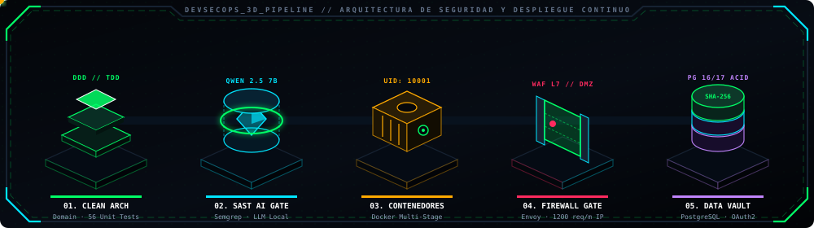
  </picture>

 

<!-- ==================== TACTICAL ARSENAL & SKILL MATRIX (RESPONSIVE TABLE) ==================== -->
<table width="100%">
  <tr>
    <td width="50%" valign="top">
      
<code>[ 01 // INGENIERIA BACKEND, LENGUAJES &amp; MOTORES DE APLICACION ]</code>

      

        
      

      <code>&gt;&gt;</code> Desarrollo de servicios modulares bajo Clean Architecture y DDD, validación criptográfica <code>HMAC-SHA256</code>, autenticación <code>OAuth2 / OIDC / JWT</code>, limitación de tasa por IP y contratos REST resilientes.
    </td>
    <td width="50%" valign="top">
      
<code>[ 02 // CIBERDEFENSA, PERSISTENCIA ACID &amp; ORQUESTACION DEVSECOPS ]</code>

      

        
      

      <code>&gt;&gt;</code> Auditoría SAST asistida por IA local (<code>Qwen 2.5 Coder 7B</code> / <code>Ollama</code>), motores relacionales con aislamiento <code>SERIALIZABLE</code>, planes <code>EXPLAIN ANALYZE</code> y contenedores <code>Docker Multi-Stage</code> no-root.
    </td>
  </tr>
</table>

 

<!-- ==================== DEFENSE-IN-DEPTH ARCHITECTURE & CODEBASE TELEMETRY ==================== -->

  <picture>
    
  </picture>

 

<!-- ==================== CYBER-ARMORED BENTO GRID: 6 FLAGSHIP REPOSITORIES ==================== -->

  

    <a href="https://github.com/Jhonmoreno000/NEXUS">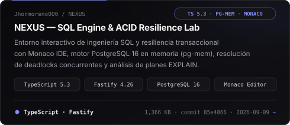</a>&nbsp;<a href="https://github.com/Jhonmoreno000/architect-td">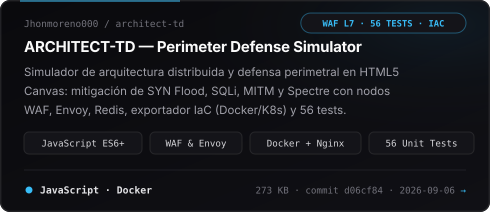</a>
  

  

    <a href="https://github.com/Jhonmoreno000/secdev">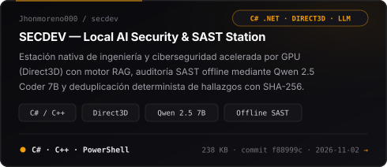</a>&nbsp;<a href="https://github.com/Jhonmoreno000/PROYECTO-SENA-TIENDA-TEXTIL-">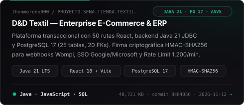</a>
  

  

    <a href="https://github.com/Jhonmoreno000/GCP-GESTION-DE-PRODUCTOS-">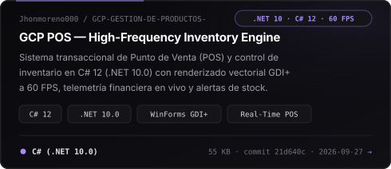</a>&nbsp;<a href="https://github.com/Jhonmoreno000/proyecto-todo-api"></a>
  

 

<!-- ==================== INTERACTIVE SOC SIMULATION & 4-SYSTEM BLUEPRINT LAB ==================== -->

  
<kbd>[ + ] CONSOLA SOC EN VIVO // AUDITORIA SAST-IA, TELEMETRIA SIEM &amp; BLUEPRINT DE ARQUITECTURA INTERNA</kbd>

   
  

    <picture>
      
    </picture>
      
    <picture>
      
    </picture>
  

 

<!-- ==================== 3D ISOMETRIC CYBER TERRAIN, PACKET HUNTER & SOC TELEMETRY ==================== -->

  <picture>
    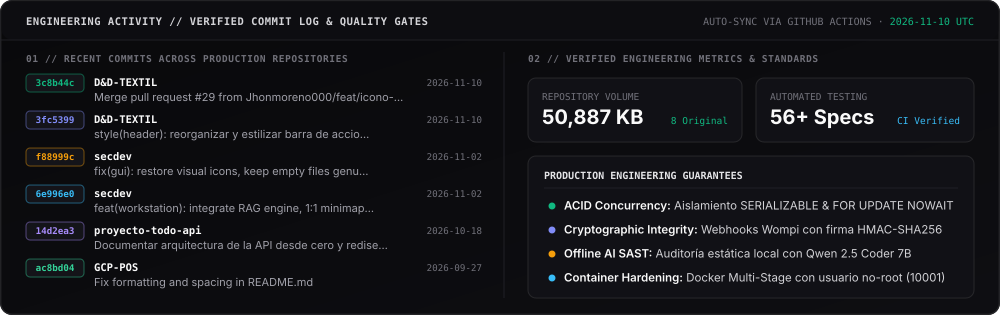
  </picture>

    

  <picture>
    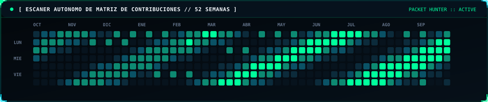
  </picture>

    

  <picture>
    
  </picture>

 

<!-- ==================== ANIMATED CYBER-PULSE HORIZON FOOTER ==================== -->

  <picture>
    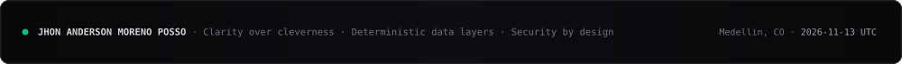
  </picture>

