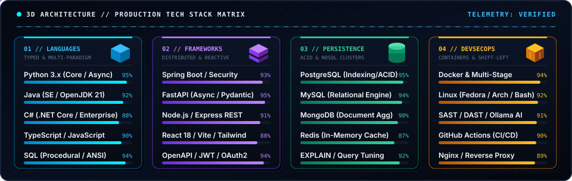

<div align="center">

  <!-- ==================== BESPOKE HERO CARD ==================== -->
  

  <br><br>

  <!-- ==================== ANIMATED SUBTITLE ==================== -->
  <a href="https://github.com/Jhonmoreno000">
    
  </a>

  <br><br>

  <!-- ==================== MINIMALIST CONTACT PILLS ==================== -->
  <p>
    <a href="https://www.linkedin.com/in/jhon-anderson-moreno-posso-7b0433407/"></a>
    &nbsp;
    <a href="mailto:morenopossojhonanderson313@gmail.com"></a>
    &nbsp;
    <a href="https://github.com/Jhonmoreno000"></a>
  </p>

</div>

---

### // 01. PROFILE & ENGINEERING PHILOSOPHY

```text
       /\         USER: jhon@systems-core
      /  \        HOST: Distributed Systems & Backend Runtime
     / /\ \       ENVIRONMENT: Linux (Fedora / Arch) // Containerized
    / /  \ \      UPTIME: 99.99% // Continuous Integration & Delivery
   / /    \ \     METHODOLOGY: Clean Architecture // DDD // TDD
  /_/      \_\    STATUS: ACTIVE // Available for High-Impact Engineering Roles

  [ENGINEERING SPECIFICATIONS]
  tenologo de Software enfocado en Backend Engineering, Arquitectura Distribuida
  y DevSecOps. Especializado en el diseno de APIs de alto rendimiento, optimizacion
  de modelos relacionales y no relacionales, y automatizacion de pipelines seguros.
```

Desarrollador de software enfocado en **Backend Engineering y Arquitectura Distribuida**. Mi trabajo se centra en construir sistemas escalables con bajo acoplamiento, diseñar APIs resilientes con contratos estrictos y automatizar pipelines con cultura DevSecOps (seguridad shift-left).

- **Backend & APIs:** Implementacion de microservicios, controladores desacoplados, DTOs tipados y persistencia relacional/NoSQL optimizada.
- **DevSecOps & Infraestructura:** Contenerizacion con Docker multi-stage, auditoria estatica automatizada (SAST/DAST) y entornos Linux de produccion.
- **Calidad de Codigo:** Adherencia a principios SOLID, Clean Code, pruebas unitarias y de integracion continuas.

---

### // 02. TECH STACK MATRIX

<div align="center">
  
</div>

---

### // 03. SELECTED REPOSITORIES & ARCHITECTURES

<div align="center">

<table>
  <thead>
    <tr>
      <th align="left">PROYECTO</th>
      <th align="left">ARQUITECTURA &amp; DETALLES TECNICOS</th>
      <th align="center">TECNOLOGIAS</th>
      <th align="center">ACCESO</th>
    </tr>
  </thead>
  <tbody>
    <tr>
      <td align="left">
        <a href="https://github.com/Jhonmoreno000/proyecto-todo-api">
          <b>proyecto-todo-api</b>
        </a>
        <br>
        <small>Microservicio RESTful</small>
      </td>
      <td align="left">
        API modular para administracion y programacion de flujos de trabajo. Arquitectura MVC con Node.js, persistencia NoSQL en MongoDB y orquestacion con Docker Compose.
      </td>
      <td align="center">
        <code>Node.js</code> <code>Express</code><br>
        <code>MongoDB</code> <code>Docker</code>
      </td>
      <td align="center">
        <a href="https://github.com/Jhonmoreno000/proyecto-todo-api">
          
        </a>
      </td>
    </tr>
    <tr>
      <td align="left">
        <a href="https://github.com/Jhonmoreno000/I-work-in-python">
          <b>I-work-in-python</b>
        </a>
        <br>
        <small>Algoritmia &amp; Estructuras</small>
      </td>
      <td align="left">
        Implementacion rigurosa de algoritmos de optimizacion, estructuras de datos avanzadas y analisis de complejidad computacional Big-O bajo Clean Code modular.
      </td>
      <td align="center">
        <code>Python 3</code> <code>Big-O</code><br>
        <code>Data Structures</code>
      </td>
      <td align="center">
        <a href="https://github.com/Jhonmoreno000/I-work-in-python">
          
        </a>
      </td>
    </tr>
    <tr>
      <td align="left">
        <a href="https://github.com/Jhonmoreno000/GCP-GESTION-DE-PRODUCTOS-">
          <b>GCP-GESTION-DE-PRODUCTOS-</b>
        </a>
        <br>
        <small>Plataforma Empresarial .NET</small>
      </td>
      <td align="left">
        Sistema empresarial de control transaccional de productos e inventarios. Desarrollado en C# (.NET Core) con arquitectura en capas y modelado relacional estructurado.
      </td>
      <td align="center">
        <code>C#</code> <code>.NET Core</code><br>
        <code>Relational SQL</code>
      </td>
      <td align="center">
        <a href="https://github.com/Jhonmoreno000/GCP-GESTION-DE-PRODUCTOS-">
          
        </a>
      </td>
    </tr>
    <tr>
      <td align="left">
        <b>AI Security Orchestrator</b>
        <br>
        <small>Arquitectura Insignia</small>
      </td>
      <td align="left">
        Plataforma autonoma para orquestacion de escaneres SAST, DAST y SCA en contenedores aislados. Modelos locales con Ollama para deduplicacion SHA-256 y parches de remediacion.
      </td>
      <td align="center">
        <code>FastAPI</code> <code>Docker</code><br>
        <code>Local AI</code> <code>DevSecOps</code>
      </td>
      <td align="center">
        
      </td>
    </tr>
    <tr>
      <td align="left">
        <b>NEXUS Database Engine</b>
        <br>
        <small>Simulador Interactivo</small>
      </td>
      <td align="left">
        Simulador interactivo de ingenieria de bases de datos para experimentacion con planes de ejecucion SQL (EXPLAIN), indexacion y optimizacion de modelos relacionales.
      </td>
      <td align="center">
        <code>TypeScript</code> <code>React</code><br>
        <code>SQL Engine</code> <code>Vite</code>
      </td>
      <td align="center">
        
      </td>
    </tr>
    <tr>
      <td align="left">
        <b>D&amp;D Textil Platform</b>
        <br>
        <small>ERP Empresarial SENA</small>
      </td>
      <td align="left">
        Ecosistema empresarial full-stack para comercializacion y gestion textil. Backend corporativo en Spring Boot, autenticacion con JWT y arquitectura reactiva en React.
      </td>
      <td align="center">
        <code>Java</code> <code>Spring Boot</code><br>
        <code>MySQL</code> <code>React</code>
      </td>
      <td align="center">
        
      </td>
    </tr>
  </tbody>
</table>

</div>

---

### // 04. GITHUB TELEMETRY & ACTIVITY

<div align="center">

<table>
  <tr>
    <td width="50%" align="center">
      
    </td>
    <td width="50%" align="center">
      
    </td>
  </tr>
  <tr>
    <td colspan="2" align="center">
      
    </td>
  </tr>
</table>

</div>

---

### // 05. TECHNICAL PROTOCOLS & RFC STANDARDS

<details>
  <summary><b>[+] 01. Principios de Arquitectura de Software</b></summary>
  <br>

  - **Clean Architecture & Domain-Driven Design:** Desacoplamiento estricto de las reglas de negocio respecto a frameworks y mecanismos de persistencia.
  - **Principios SOLID:** Responsabilidad unica por modulo, segregacion de interfaces e inversion de dependencias para facilitar testing.
  - **Estrategia de Pruebas (TDD):** Cobertura orientada a casos de uso criticos mediante tests unitarios y de integracion.
  - **Contratos de API REST:** Formato de respuesta consistente, DTOs con validacion estricta y documentacion con OpenAPI.

</details>

<details>
  <summary><b>[+] 02. Estandares DevSecOps & Infraestructura</b></summary>
  <br>

  - **Seguridad Shift-Left:** Escaneo estatico de vulnerabilidades (SAST) y dependencias desactualizadas (SCA) en fase temprana.
  - **Optimizacion de Contenedores:** Creacion de imagenes Docker multi-stage, usuarios no-root y reduccion de vectores de ataque.
  - **CI/CD Automatizado:** Verificacion automatica de formato, linters y suites de tests en cada integracion de rama.
  - **Trazabilidad:** Logs estructurados y configuracion estricta de variables de entorno mediante secretos.

</details>

<details>
  <summary><b>[+] 03. Formacion Profesional & Objetivos</b></summary>
  <br>

  - **ADSO (SENA):** Analisis y Desarrollo de Software — Enfocado en la construccion de software corporativo y buenas practicas de ingenieria.
  - **Ruta de Crecimiento:** Profundizacion en orquestacion de contenedores con Kubernetes, colas de mensajeria asincronas y sistemas de alta disponibilidad.

</details>

---

<div align="center">

  ```text
  "Controlling complexity is the essence of computer programming." — Brian W. Kernighan
  ```

  <br>

  <p><code>JHON ANDERSON MORENO POSSO // MEDELLIN, COLOMBIA // 2026</code></p>

</div>
