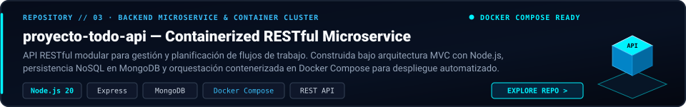
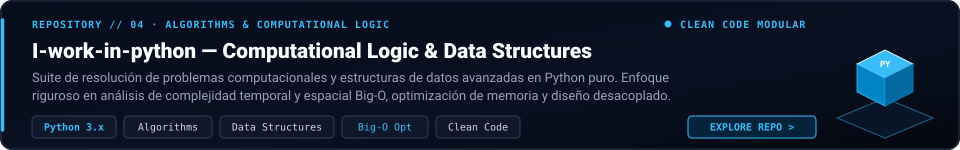
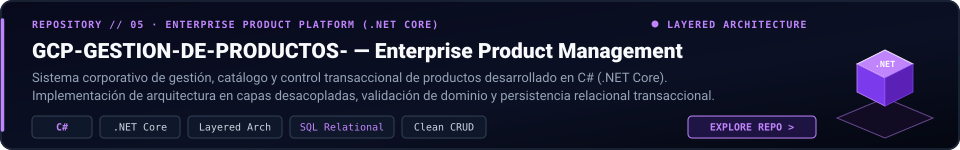
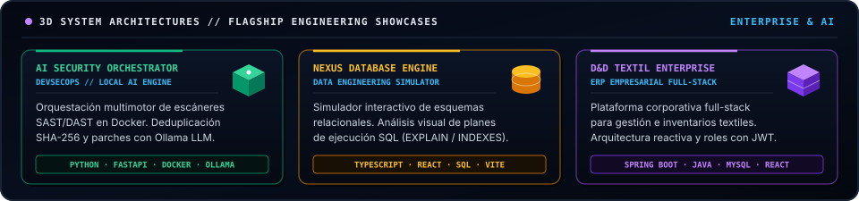

<div align="center">

  <!-- ==================== BESPOKE HERO COMPONENT ==================== -->
  

  <br><br>

  <!-- ==================== ANIMATED TERMINAL SUBTITLE ==================== -->
  <a href="https://github.com/Jhonmoreno000">
    
  </a>

  <br><br>

  <!-- ==================== MINIMALIST CONTACT PILLS ==================== -->
  <p>
    <a href="https://www.linkedin.com/in/jhon-anderson-moreno-posso-7b0433407/"></a>
    &nbsp;
    <a href="mailto:morenopossojhonanderson313@gmail.com"></a>
    &nbsp;
    <a href="https://github.com/Jhonmoreno000"></a>
  </p>

</div>

---

### // 01. PROFILE & EXECUTIVE SUMMARY

```text
  LOCATION     : Medellin, Antioquia, Colombia [UTC-5]
  FORMATION    : Analisis y Desarrollo de Software (ADSO) - SENA
  ROLE         : Tecnologo en Desarrollo de Software // Backend & DevSecOps
  CORE STACK   : Python, Java, C#, Docker, PostgreSQL, Linux
  PARADIGM     : Clean Architecture, TDD, Domain-Driven Design
```

Desarrollador de software enfocado en **Backend Engineering, Arquitectura Distribuida y DevSecOps**. Especializado en la construccion de microservicios resilientes con bajo acoplamiento, diseno de APIs robustas con contratos estrictos y automatizacion de pipelines seguros con cultura shift-left.

- **Backend & APIs:** Implementacion de microservicios modulares, controladores desacoplados, DTOs tipados y persistencia relacional/NoSQL optimizada.
- **DevSecOps & Infraestructura:** Contenerizacion con Docker multi-stage, auditoria estatica automatizada (SAST/DAST) y despliegue en entornos Linux.
- **Calidad de Codigo:** Adherencia estricta a principios SOLID, Clean Code, pruebas unitarias y de integracion continuas.

---

### // 02. TECH STACK MATRIX

<div align="center">
  
</div>

---

### // 03. FEATURED REPOSITORIES // DEPLOYMENTS

<div align="center">

  <!-- REPOSITORY CARD 01 -->
  <a href="https://github.com/Jhonmoreno000/proyecto-todo-api">
    
  </a>

  <br><br>

  <!-- REPOSITORY CARD 02 -->
  <a href="https://github.com/Jhonmoreno000/I-work-in-python">
    
  </a>

  <br><br>

  <!-- REPOSITORY CARD 03 -->
  <a href="https://github.com/Jhonmoreno000/GCP-GESTION-DE-PRODUCTOS-">
    
  </a>

</div>

---

### // 04. FLAGSHIP ARCHITECTURES & SYSTEMS DESIGN

<div align="center">
  
</div>

---

### // 05. DEVSECOPS & CI/CD PIPELINE

```text
+------------------+      +-------------------+      +--------------------+
|  SOURCE CONTROL  | ---> |  SECURITY & SAST  | ---> |   CONTAINER BUILD  |
|  Git / CI Runner |      |  Ollama / Semgrep |      |   Docker Multi-Stage|
+------------------+      +-------------------+      +--------------------+
          |                                                     |
          v                                                     v
+------------------+                                 +--------------------+
| AUTOMATED TESTS  | ------------------------------> | SECURE DEPLOYMENT  |
| Unit / Integ TDD |                                 | Nginx / Cloud Host |
+------------------+                                 +--------------------+
```

---

### // 06. GITHUB TELEMETRY & ACTIVITY

<div align="center">

<table>
  <tr>
    <td width="50%" align="center">
      
    </td>
    <td width="50%" align="center">
      
    </td>
  </tr>
  <tr>
    <td colspan="2" align="center">
      
    </td>
  </tr>
</table>

</div>

---

### // 07. TECHNICAL RFC STANDARDS & PROTOCOLS

<details>
  <summary><b>[+] 01. Principios de Arquitectura de Software</b></summary>
  <br>

  - **Clean Architecture & Domain-Driven Design:** Desacoplamiento estricto de las reglas de negocio respecto a frameworks y mecanismos de persistencia.
  - **Principios SOLID:** Responsabilidad unica por modulo, segregacion de interfaces e inversion de dependencias para facilitar testing.
  - **Estrategia de Pruebas (TDD):** Cobertura orientada a casos de uso criticos mediante tests unitarios y de integracion.
  - **Contratos de API REST:** Formato de respuesta consistente, DTOs con validacion estricta y documentacion con OpenAPI.

</details>

<details>
  <summary><b>[+] 02. Estandares DevSecOps & Infraestructura</b></summary>
  <br>

  - **Seguridad Shift-Left:** Escaneo estatico de vulnerabilidades (SAST) y dependencias desactualizadas (SCA) en fase temprana.
  - **Optimizacion de Contenedores:** Creacion de imagenes Docker multi-stage, usuarios no-root y reduccion de vectores de ataque.
  - **CI/CD Automatizado:** Verificacion automatica de formato, linters y suites de tests en cada integracion de rama.
  - **Trazabilidad:** Logs estructurados y configuracion estricta de variables de entorno mediante secretos.

</details>

<details>
  <summary><b>[+] 03. Formacion Profesional & Trayectoria</b></summary>
  <br>

  - **ADSO (SENA):** Analisis y Desarrollo de Software — Enfocado en construccion de software corporativo y buenas practicas de ingenieria.
  - **Ruta de Crecimiento:** Profundizacion en orquestacion de contenedores con Kubernetes, colas de mensajeria asincronas y sistemas de alta disponibilidad.

</details>

---

<div align="center">

  ```text
  "Controlling complexity is the essence of computer programming." — Brian W. Kernighan
  ```

  <br>

  <p><code>JHON ANDERSON MORENO POSSO // MEDELLIN, COLOMBIA // 2026</code></p>

</div>
