

  <!-- ==================== 00 // TRUE 3D WEBGL COMMAND MONOLITH (DUAL DARK / LIGHT) ==================== -->
  <picture>
    <source media="(prefers-color-scheme: dark)" srcset="./assets/hero-3d-dark.png" />
    <source media="(prefers-color-scheme: light)" srcset="./assets/hero-3d-light.png" />
    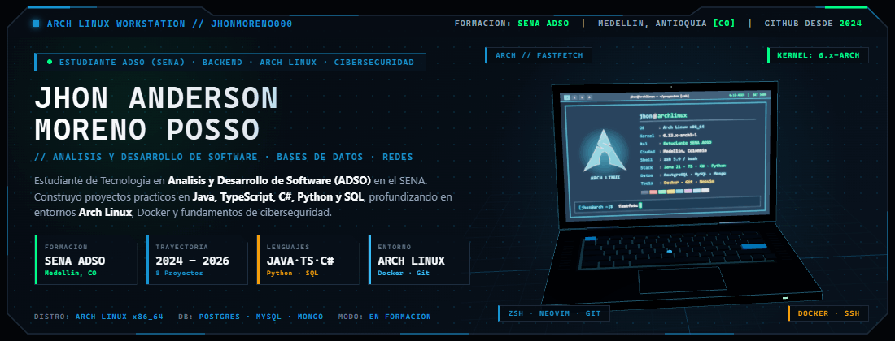
  </picture>

  <!-- ==================== LIVE CONTEXT-AWARE SOC TELEMETRY RIBBON (MEDELLIN SHIFT + CISA KEV + GITHUB API) ==================== -->
  <picture>
    <source media="(prefers-color-scheme: dark)" srcset="./assets/live-telemetry-dark.svg" />
    <source media="(prefers-color-scheme: light)" srcset="./assets/live-telemetry-light.svg" />
    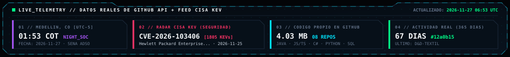
  </picture>

    

  <!-- ==================== PRECISION MONOSPACE NAVIGATION ==================== -->
  

    <samp>
      <a href="https://www.linkedin.com/in/jhon-anderson-moreno-posso-7b0433407/"><kbd>&nbsp;LINKEDIN&nbsp;</kbd></a>
      &nbsp;&nbsp;
      <a href="mailto:morenopossojhonanderson313@gmail.com"><kbd>&nbsp;DIRECT MAIL&nbsp;</kbd></a>
      &nbsp;&nbsp;
      <a href="https://github.com/Jhonmoreno000?tab=repositories"><kbd>&nbsp;REPOSITORIES&nbsp;</kbd></a>
      &nbsp;&nbsp;
      <a href="#01--flagship-3d-systems--production-architectures"><kbd>&nbsp;SYSTEMS&nbsp;</kbd></a>
      &nbsp;&nbsp;
      <a href="#04--interactive-zero-trust-perimeter--live-soc-challenge"><kbd>&nbsp;INTERACTIVE CTF&nbsp;</kbd></a>
    </samp>
  

---

### `01` // Flagship 3D Systems & Production Architectures

> **Engineering Standard:** Explicit domain contracts, deterministic `SERIALIZABLE` ACID persistence, hardware-accelerated native tooling, and verifiable Shift-Left AppSec (`OWASP ASVS L2` + offline `Qwen 2.5 Coder 7B` SAST).

  

    <a href="https://github.com/Jhonmoreno000/PROYECTO-SENA-TIENDA-TEXTIL-"><picture><source media="(prefers-color-scheme: dark)" srcset="./assets/bento-textil-dark.svg" /><source media="(prefers-color-scheme: light)" srcset="./assets/bento-textil-light.svg" />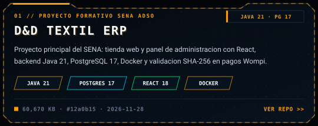</picture></a>&nbsp;<a href="https://github.com/Jhonmoreno000/NEXUS"><picture><source media="(prefers-color-scheme: dark)" srcset="./assets/bento-nexus-dark.svg" /><source media="(prefers-color-scheme: light)" srcset="./assets/bento-nexus-light.svg" />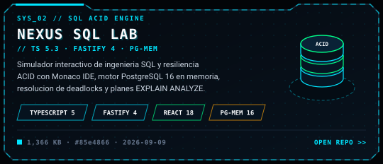</picture></a>
  

  

    <a href="https://github.com/Jhonmoreno000/secdev"><picture><source media="(prefers-color-scheme: dark)" srcset="./assets/bento-secdev-dark.svg" /><source media="(prefers-color-scheme: light)" srcset="./assets/bento-secdev-light.svg" />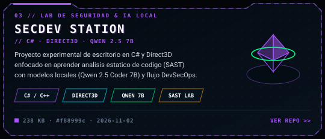</picture></a>&nbsp;<a href="https://github.com/Jhonmoreno000/architect-td"><picture><source media="(prefers-color-scheme: dark)" srcset="./assets/bento-architect-dark.svg" /><source media="(prefers-color-scheme: light)" srcset="./assets/bento-architect-light.svg" />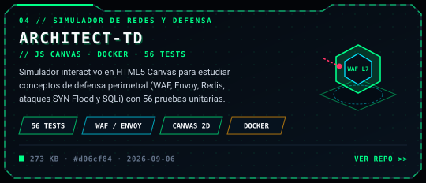</picture></a>
  

  

    <a href="https://github.com/Jhonmoreno000/GCP-GESTION-DE-PRODUCTOS-"><picture><source media="(prefers-color-scheme: dark)" srcset="./assets/bento-gcp-dark.svg" /><source media="(prefers-color-scheme: light)" srcset="./assets/bento-gcp-light.svg" />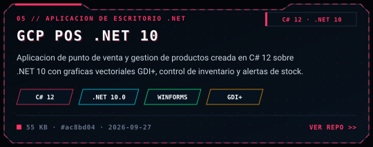</picture></a>&nbsp;<a href="https://github.com/Jhonmoreno000/proyecto-todo-api"><picture><source media="(prefers-color-scheme: dark)" srcset="./assets/bento-todo-dark.svg" /><source media="(prefers-color-scheme: light)" srcset="./assets/bento-todo-light.svg" />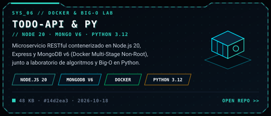</picture></a>
  

  
<samp><b>[ + ] INTERACTIVE ZERO-TRUST TOPOLOGY BLUEPRINT &amp; ARCHITECTURE DECISION RECORDS (ADRs)</b></samp>

   

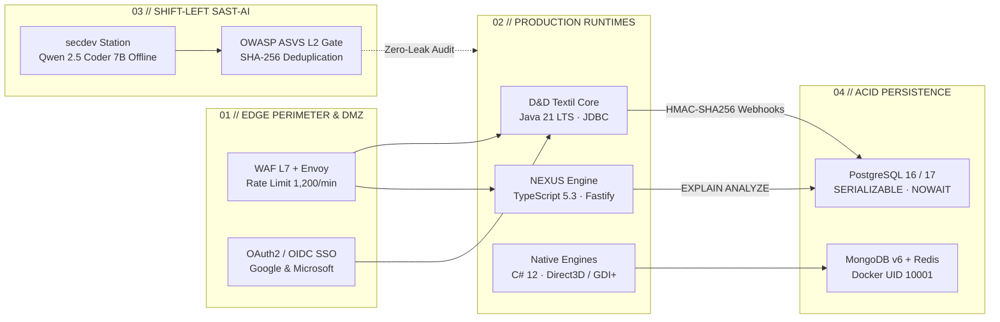

| System | Core Engineering Problem Solved | Key Architectural Decision (ADR) |
| :--- | :--- | :--- |
| **[D&D Textil ERP](https://github.com/Jhonmoreno000/PROYECTO-SENA-TIENDA-TEXTIL-)** | B2C E-Commerce + 3-role ERP with real payment gateways and atomic inventory. | **ADR-01:** `Java 21 LTS` + `PostgreSQL 17` (25 tables, 20 FKs), `HMAC-SHA256` Wompi webhook verification, OIDC SSO, and IP Rate Limiting (`1,200 req/min`). |
| **[NEXUS SQL Engine](https://github.com/Jhonmoreno000/NEXUS)** | Interactive SQL concurrency & deadlock diagnostics in isolated sandboxes. | **ADR-02:** `Monaco Editor` + `TypeScript 5.3 / Fastify 4.26` + in-memory `PostgreSQL 16 (pg-mem)` with `EXPLAIN (ANALYZE, BUFFERS)` evaluation. |
| **[secdev Workstation](https://github.com/Jhonmoreno000/secdev)** | Native cybersecurity IDE & SAST code audit with zero cloud code exfiltration. | **ADR-03:** `C# / C++` GPU-accelerated `Direct3D` viewport, local RAG index, offline `Qwen 2.5 Coder 7B` inference, deterministic `SHA-256` finding hashing. |
| **[architect-td](https://github.com/Jhonmoreno000/architect-td)** | Distributed infrastructure & Layer-7 perimeter attack mitigation simulator. | **ADR-04:** `HTML5 Canvas` simulation engine (`WAF L7`, `Envoy`, `Redis`, `Circuit Breaker`) against SYN Flood/SQLi/MITM/Spectre + `56 unit tests` + IaC export. |
| **[GCP POS (.NET 10)](https://github.com/Jhonmoreno000/GCP-GESTION-DE-PRODUCTOS-)** | Zero-flicker high-frequency desktop Point of Sale & real-time stock telemetry. | **ADR-05:** `C# 12` on `.NET 10.0` using double-buffered vector `GDI+` rendering at `60 FPS` and automated threshold alerting. |
| **[Todo-API](https://github.com/Jhonmoreno000/proyecto-todo-api) & [Python Lab](https://github.com/Jhonmoreno000/I-work-in-python)** | Hardened containerized REST API + algorithmic Big-O complexity laboratory. | **ADR-06:** Multi-stage non-root `Docker Compose` (`Node.js 20` + `MongoDB v6`), `/api/health` probes, and `Python 3.12` data structures. |

---

### `02` // Real 3D Contribution Skyline & Verified Source Telemetry

  <picture>
    <source media="(prefers-color-scheme: dark)" srcset="./assets/skyline-3d-dark.svg" />
    <source media="(prefers-color-scheme: light)" srcset="./assets/skyline-3d-light.svg" />
    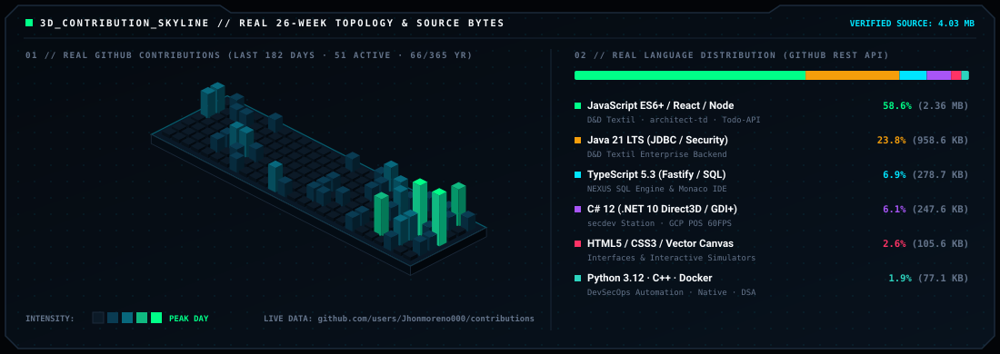
  </picture>

---

### `03` // Live SOC Engineering Audit Console & 6-Axis Capability Radar

  <picture>
    <source media="(prefers-color-scheme: dark)" srcset="./assets/ops-console-dark.svg" />
    <source media="(prefers-color-scheme: light)" srcset="./assets/ops-console-light.svg" />
    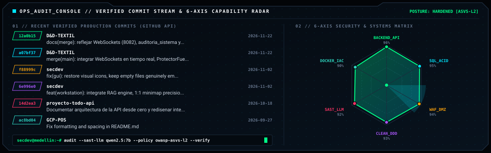
  </picture>

---

### `04` // Interactive Zero-Trust Perimeter // Live SOC Challenge

> **Live Interactive CI/CD Module:** Haz clic en cualquier vector de comando para abrir un Issue pre-configurado en 1 clic. En segundos, el workflow [`soc-interactive.yml`](./.github/workflows/soc-interactive.yml) ejecutara la auditoria, actualizara el **HUD 3D del Perimetro**, generara tu firma criptografica `SHA-256` y te agregara automaticamente al **Verified Operators Ledger**.

  <picture>
    <source media="(prefers-color-scheme: dark)" srcset="./assets/ctf-perimeter-dark.svg" />
    <source media="(prefers-color-scheme: light)" srcset="./assets/ctf-perimeter-light.svg" />
    
  </picture>

    

  

    <samp>
      <a href="https://github.com/Jhonmoreno000/Jhonmoreno000/issues/new?title=SOC_CMD:%20PROBE_WAF_L7&body=Submit%20this%20issue%20to%20launch%20a%20simulated%20Layer-7%20WAF%20probe%20against%20the%20Zero-Trust%20perimeter%20and%20receive%20your%20SHA-256%20operator%20signature."><kbd>&nbsp;01 // PROBE_WAF_L7&nbsp;</kbd></a>
      &nbsp;&nbsp;
      <a href="https://github.com/Jhonmoreno000/Jhonmoreno000/issues/new?title=SOC_CMD:%20AUDIT_SQL_DEADLOCK&body=Submit%20this%20issue%20to%20run%20a%20PostgreSQL%20SERIALIZABLE%20%2F%20FOR%20UPDATE%20NOWAIT%20concurrency%20audit%20and%20log%20your%20operator%20signature."><kbd>&nbsp;02 // AUDIT_SQL_DEADLOCK&nbsp;</kbd></a>
      &nbsp;&nbsp;
      <a href="https://github.com/Jhonmoreno000/Jhonmoreno000/issues/new?title=SOC_CMD:%20RUN_SAST_QWEN_SCAN&body=Submit%20this%20issue%20to%20trigger%20an%20OWASP%20ASVS%20L2%20offline%20SAST%20verification%20check%20and%20receive%20your%20SHA-256%20signature."><kbd>&nbsp;03 // RUN_SAST_QWEN_SCAN&nbsp;</kbd></a>
      &nbsp;&nbsp;
      <a href="https://github.com/Jhonmoreno000/Jhonmoreno000/issues/new?title=SOC_CMD:%20SIGN_OPERATOR_LOG&body=Submit%20this%20issue%20to%20cryptographically%20sign%20the%20Verified%20Operators%20Ledger%20on%20this%20profile."><kbd>&nbsp;04 // SIGN_OPERATOR_LOG&nbsp;</kbd></a>
    </samp>
  

  
<samp><b>[ + ] VERIFIED OPERATORS CRYPTOGRAPHIC LEDGER (AUTO-UPDATED BY GITHUB ACTIONS)</b></samp>

   

<!-- SOC_LEDGER_START -->
| Operator | Command Vector | Verification Result | SHA-256 Signature | Date (UTC) |
| :--- | :--- | :--- | :--- | :--- |
| `@Jhonmoreno000` | `BOOT_ZERO_TRUST_CORE` | `SHIELD_ARMED_ASVS_L2` | `9f86d081884c7d65` | `2026-11-24` |
<!-- SOC_LEDGER_END -->

---

  <picture>
    <source media="(prefers-color-scheme: dark)" srcset="./assets/footer-3d-dark.svg" />
    <source media="(prefers-color-scheme: light)" srcset="./assets/footer-3d-light.svg" />
    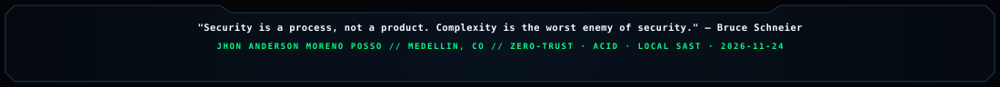
  </picture>

