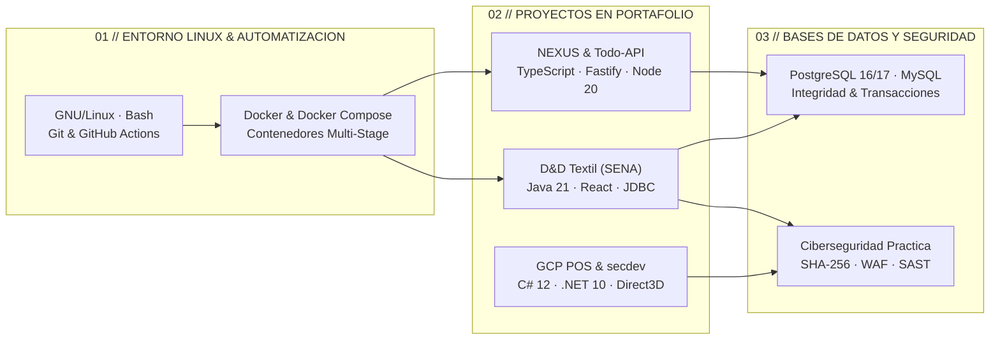

  <!-- ==================== 00 // 3D WEBGL ARCH LINUX WORKSTATION HERO (DUAL DARK / LIGHT) ==================== -->
  <picture>
    <source media="(prefers-color-scheme: dark)" srcset="./assets/hero-3d-dark.png?v=5" />
    <source media="(prefers-color-scheme: light)" srcset="./assets/hero-3d-light.png?v=5" />
    
  </picture>

  <!-- ==================== LIVE TELEMETRY RIBBON (MEDELLIN TIME + CISA KEV + GITHUB API) ==================== -->
  <picture>
    <source media="(prefers-color-scheme: dark)" srcset="./assets/live-telemetry-dark.svg?v=4" />
    <source media="(prefers-color-scheme: light)" srcset="./assets/live-telemetry-light.svg?v=4" />
    
  </picture>

    

  <!-- ==================== NAVEGACION RAPIDA ==================== -->
  

    <samp>
      <a href="https://www.linkedin.com/in/jhon-anderson-moreno-posso-7b0433407/"><kbd>&nbsp;LINKEDIN&nbsp;</kbd></a>
      &nbsp;&nbsp;
      <a href="mailto:morenopossojhonanderson313@gmail.com"><kbd>&nbsp;CORREO&nbsp;</kbd></a>
      &nbsp;&nbsp;
      <a href="https://github.com/Jhonmoreno000?tab=repositories"><kbd>&nbsp;REPOSITORIOS&nbsp;</kbd></a>
      &nbsp;&nbsp;
      <a href="#01--proyectos-en-formacion-y-practica-real"><kbd>&nbsp;PROYECTOS&nbsp;</kbd></a>
      &nbsp;&nbsp;
      <a href="#04--laboratorio-interactivo-linux--github-actions"><kbd>&nbsp;LAB INTERACTIVO&nbsp;</kbd></a>
    </samp>
  

---

### `01` // Proyectos en Formacion y Practica Real

> **Sobre mi:** Soy estudiante de **Tecnologia en Analisis y Desarrollo de Software (ADSO)** en el **SENA** (Medellin, Colombia). Aprendo construyendo proyectos reales de principio a fin: APIs backend, bases de datos relacionales, contenedores en **Linux / Docker** y practicas de ciberseguridad aplicada.

  

    <a href="https://github.com/Jhonmoreno000/PROYECTO-SENA-TIENDA-TEXTIL-"><picture><source media="(prefers-color-scheme: dark)" srcset="./assets/bento-textil-dark.svg?v=4" /><source media="(prefers-color-scheme: light)" srcset="./assets/bento-textil-light.svg?v=4" /></picture></a>&nbsp;<a href="https://github.com/Jhonmoreno000/NEXUS"><picture><source media="(prefers-color-scheme: dark)" srcset="./assets/bento-nexus-dark.svg?v=4" /><source media="(prefers-color-scheme: light)" srcset="./assets/bento-nexus-light.svg?v=4" /></picture></a>
  

  

    <a href="https://github.com/Jhonmoreno000/secdev"><picture><source media="(prefers-color-scheme: dark)" srcset="./assets/bento-secdev-dark.svg?v=4" /><source media="(prefers-color-scheme: light)" srcset="./assets/bento-secdev-light.svg?v=4" /></picture></a>&nbsp;<a href="https://github.com/Jhonmoreno000/architect-td"><picture><source media="(prefers-color-scheme: dark)" srcset="./assets/bento-architect-dark.svg?v=4" /><source media="(prefers-color-scheme: light)" srcset="./assets/bento-architect-light.svg?v=4" /></picture></a>
  

  

    <a href="https://github.com/Jhonmoreno000/GCP-GESTION-DE-PRODUCTOS-"><picture><source media="(prefers-color-scheme: dark)" srcset="./assets/bento-gcp-dark.svg?v=4" /><source media="(prefers-color-scheme: light)" srcset="./assets/bento-gcp-light.svg?v=4" /></picture></a>&nbsp;<a href="https://github.com/Jhonmoreno000/proyecto-todo-api"><picture><source media="(prefers-color-scheme: dark)" srcset="./assets/bento-todo-dark.svg?v=4" /><source media="(prefers-color-scheme: light)" srcset="./assets/bento-todo-light.svg?v=4" /></picture></a>
  

  
<samp><b>[ + ] MAPA DE TECNOLOGIAS Y DETALLE TECNICO DE MIS PROYECTOS</b></samp>

   

| Proyecto | Contexto Real | Tecnologias Aplicadas |
| :--- | :--- | :--- |
| **[D&D Textil](https://github.com/Jhonmoreno000/PROYECTO-SENA-TIENDA-TEXTIL-)** | Proyecto formativo principal en el SENA (ADSO): tienda web y panel de gestion. | `Java 21 LTS`, `React 18 + Vite`, `PostgreSQL 17`, `Docker`, validacion `SHA-256` en webhooks Wompi y SSO. |
| **[NEXUS](https://github.com/Jhonmoreno000/NEXUS)** | Laboratorio personal para estudiar consultas SQL, bloqueos y planes `EXPLAIN`. | `TypeScript 5.3`, `Fastify 4.26`, `React 18`, `Monaco Editor`, `PostgreSQL 16 (pg-mem)`. |
| **[secdev](https://github.com/Jhonmoreno000/secdev)** | Proyecto experimental para aprender analisis estatico SAST con IA local. | `C#`, `C++`, `Direct3D`, `Qwen 2.5 Coder 7B` en entorno local y deduplicacion `SHA-256`. |
| **[architect-td](https://github.com/Jhonmoreno000/architect-td)** | Simulador en navegador para practicar conceptos de defensa de redes y capa 7. | `JavaScript ES6+`, `HTML5 Canvas`, `Docker + Nginx`, `56 pruebas unitarias`. |
| **[GCP POS](https://github.com/Jhonmoreno000/GCP-GESTION-DE-PRODUCTOS-)** | Aplicacion de escritorio para inventario y punto de venta. | `C# 12`, `.NET 10.0`, `WinForms GDI+` con graficas y alertas de stock. |
| **[Todo-API](https://github.com/Jhonmoreno000/proyecto-todo-api) & [Python](https://github.com/Jhonmoreno000/I-work-in-python)** | Practica de APIs contenerizadas y fundamentos de algoritmos. | `Node.js 20`, `Express`, `MongoDB v6`, `Docker Compose`, `Python 3.12`. |

---

### `02` // Skyline 3D de Contribuciones Reales & Lenguajes en GitHub

  <picture>
    <source media="(prefers-color-scheme: dark)" srcset="./assets/skyline-3d-dark.svg?v=4" />
    <source media="(prefers-color-scheme: light)" srcset="./assets/skyline-3d-light.svg?v=4" />
    
  </picture>

---

### `03` // Commits Recientes & Mi Trayectoria como Estudiante (2024 - 2026)

  <picture>
    <source media="(prefers-color-scheme: dark)" srcset="./assets/ops-console-dark.svg?v=4" />
    <source media="(prefers-color-scheme: light)" srcset="./assets/ops-console-light.svg?v=4" />
    
  </picture>

---

### `04` // Laboratorio Interactivo Linux & GitHub Actions

> **Automatizacion en vivo:** Este modulo funciona con [`soc-interactive.yml`](./.github/workflows/soc-interactive.yml). Si haces clic en cualquier comando, se abre un Issue pre-configurado; al enviarlo, GitHub Actions ejecuta [`scripts/process_soc_action.mjs`](./scripts/process_soc_action.mjs), actualiza los contadores reales del SVG, genera una firma `SHA-256` unica y te registra en la tabla de visitantes.

  <picture>
    <source media="(prefers-color-scheme: dark)" srcset="./assets/ctf-perimeter-dark.svg?v=4" />
    <source media="(prefers-color-scheme: light)" srcset="./assets/ctf-perimeter-light.svg?v=4" />
    
  </picture>

    

  

    <samp>
      <a href="https://github.com/Jhonmoreno000/Jhonmoreno000/issues/new?title=SOC_CMD:%20PROBE_WAF_L7&body=Envia%20este%20Issue%20para%20ejecutar%20una%20prueba%20WAF%20L7%20en%20GitHub%20Actions%20y%20recibir%20tu%20firma%20SHA-256."><kbd>&nbsp;01 // PROBE_WAF_L7&nbsp;</kbd></a>
      &nbsp;&nbsp;
      <a href="https://github.com/Jhonmoreno000/Jhonmoreno000/issues/new?title=SOC_CMD:%20AUDIT_SQL_DEADLOCK&body=Envia%20este%20Issue%20para%20ejecutar%20el%20test%20de%20laboratorio%20SQL%20en%20GitHub%20Actions%20y%20recibir%20tu%20firma%20SHA-256."><kbd>&nbsp;02 // AUDIT_SQL_DEADLOCK&nbsp;</kbd></a>
      &nbsp;&nbsp;
      <a href="https://github.com/Jhonmoreno000/Jhonmoreno000/issues/new?title=SOC_CMD:%20RUN_SAST_QWEN_SCAN&body=Envia%20este%20Issue%20para%20probar%20el%20flujo%20automatizado%20SAST%20en%20GitHub%20Actions%20y%20recibir%20tu%20firma%20SHA-256."><kbd>&nbsp;03 // RUN_SAST_QWEN_SCAN&nbsp;</kbd></a>
      &nbsp;&nbsp;
      <a href="https://github.com/Jhonmoreno000/Jhonmoreno000/issues/new?title=SOC_CMD:%20SIGN_OPERATOR_LOG&body=Envia%20este%20Issue%20para%20firmar%20el%20libro%20de%20visitantes%20con%20SHA-256%20via%20GitHub%20Actions."><kbd>&nbsp;04 // FIRMAR_LIBRO_VISITAS&nbsp;</kbd></a>
    </samp>
  

  
<samp><b>[ + ] REGISTRO DE VISITANTES (ACTUALIZADO AUTOMATICAMENTE POR GITHUB ACTIONS)</b></samp>

   

<!-- SOC_LEDGER_START -->
| Operator | Command Vector | Verification Result | SHA-256 Signature | Date (UTC) |
| :--- | :--- | :--- | :--- | :--- |
| `@Jhonmoreno000` | `INIT_LINUX_LAB` | `LAB_INITIALIZED` | `9f86d081884c7d65` | `2026-11-24` |
<!-- SOC_LEDGER_END -->

---

  <picture>
    <source media="(prefers-color-scheme: dark)" srcset="./assets/footer-3d-dark.svg?v=4" />
    <source media="(prefers-color-scheme: light)" srcset="./assets/footer-3d-light.svg?v=4" />
    
  </picture>

