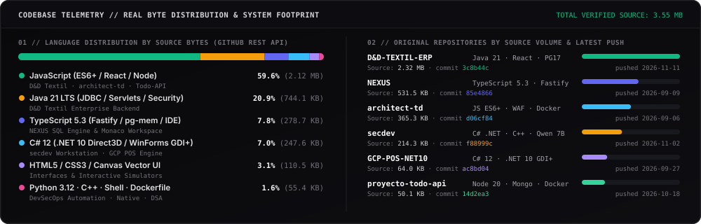

  <!-- ==================== EXECUTIVE HERO: LINEAR / VERCEL ARCHITECTURE MANIFEST ==================== -->
  <picture>
    <source media="(prefers-color-scheme: dark)" srcset="https://raw.githubusercontent.com/Jhonmoreno000/Jhonmoreno000/main/assets/hero-senior.svg?v=2" />
    <source media="(prefers-color-scheme: light)" srcset="https://raw.githubusercontent.com/Jhonmoreno000/Jhonmoreno000/main/assets/hero-senior.svg?v=2" />
    
  </picture>

   

  <!-- ==================== MINIMALIST MONOSPACE NAVIGATION BAR ==================== -->
  

    <samp>
      <a href="https://www.linkedin.com/in/jhon-anderson-moreno-posso-7b0433407/">LinkedIn</a>
      &nbsp;·&nbsp;
      <a href="mailto:morenopossojhonanderson313@gmail.com">morenopossojhonanderson313@gmail.com</a>
      &nbsp;·&nbsp;
      <a href="https://github.com/Jhonmoreno000?tab=repositories">Repositories (09)</a>
      &nbsp;·&nbsp;
      <a href="#02--flagship-systems--production-architectures">Systems Architecture</a>
      &nbsp;·&nbsp;
      Medellín, CO (UTC-5)
    </samp>
  

---

### `01` · Architectural Philosophy & Core Stack

> **Principio de ingeniería:** Priorizo contratos de dominio explícitos, aislamiento transaccional determinista en base de datos y seguridad verificable desde el diseño (*Shift-Left AppSec*) por encima de abstracciones innecesarias.

| Dominio Arquitectónico | Stack Principal & Runtimes | Prácticas de Ingeniería & Garantías en Producción |
| :--- | :--- | :--- |
| **Backend & Servicios** | `Java 21 LTS` · `TypeScript 5.3` · `C# 12 (.NET 10)` · `Node.js 20` · `Python 3.12` | Clean Architecture, diseño orientado al dominio (**DDD**), APIs RESTful sobre **Fastify 4.26**, **Java JDBC/Servlets** y **Express**, manejo estricto de errores e idempotencia. |
| **Persistencia & Datos ACID** | `PostgreSQL 16 / 17` · `pg-mem` · `MySQL` · `MongoDB v6` · `Redis` | Aislamiento `SERIALIZABLE`, bloqueo pesimista `FOR UPDATE NOWAIT`, mitigación de *deadlocks*, integridad referencial (**25+ tablas / 20 FKs**) y auditoría `EXPLAIN (ANALYZE, BUFFERS)`. |
| **AppSec & Auditoría SAST-IA** | `OWASP ASVS L2` · `HMAC-SHA256` · `OAuth2 / OIDC` · `Qwen 2.5 Coder 7B` | Verificación criptográfica de webhooks transaccionales (**Wompi**), federación SSO (**Google / Microsoft**), análisis estático AST local sin fuga de código y deduplicación `SHA-256`. |
| **Infraestructura & Runtime** | `Docker Multi-Stage` · `Nginx / Envoy` · `GitHub Actions` · `Direct3D / GDI+` | Contenedores endurecidos con usuario sin privilegios (`UID 10001`), *rate limiting* L7 por IP (`1,200 req/min`), *health probes* y renderizado nativo acelerado por hardware a `60 FPS`. |

---

### `02` · Flagship Systems & Production Architectures

  

    &nbsp;
  

  

    &nbsp;
  

  

    &nbsp;
  

  
<samp><b>[ + ] Architecture Decision Records (ADRs) &amp; Especificaciones Técnicas de Sistemas</b></samp>

   

  | Sistema | Caso de Ingeniería Resuelto | Decisiones Clave de Arquitectura (ADR) |
  | :--- | :--- | :--- |
  | **[D&D Textil ERP](https://github.com/Jhonmoreno000/PROYECTO-SENA-TIENDA-TEXTIL-)** | Ecosistema E-Commerce B2C y ERP administrativo/vendedor con pasarelas de pago reales y control de inventario textil. | **ADR-01:** Backend en **Java 21 LTS** acoplado a **PostgreSQL 17** (25 tablas, 20 llaves foráneas) con validación criptográfica `HMAC-SHA256` en webhooks de **Wompi**, SSO OAuth2/OIDC (Google/Microsoft) y limitador de tasa de `1,200 req/min/IP`. |
  | **[NEXUS SQL Engine](https://github.com/Jhonmoreno000/NEXUS)** | Plataforma interactiva para entrenar y auditar ingeniería SQL, bloqueos concurrentes y resiliencia transaccional ACID. | **ADR-02:** Ejecución híbrida con **Monaco Editor**, API en **TypeScript 5.3 + Fastify 4.26** y motor **PostgreSQL 16 (`pg-mem`)** aislado por sesión para simular anomalías de concurrencia y evaluar planes `EXPLAIN`. |
  | **[secdev Workstation](https://github.com/Jhonmoreno000/secdev)** | Estación de trabajo nativa para desarrollo seguro y auditoría SAST sin enviar código propietario a nubes externas. | **ADR-03:** Interfaz nativa en **C# / C++** con aceleración **Direct3D**, motor RAG local e inferencia offline con **Qwen 2.5 Coder 7B**, aplicando deduplicación determinista `SHA-256` sobre hallazgos de seguridad. |
  | **[architect-td](https://github.com/Jhonmoreno000/architect-td)** | Simulador interactivo de topologías distribuidas y mitigación de vectores de red/aplicación en tiempo real. | **ADR-04:** Motor de simulación en **JavaScript ES6+ (HTML5 Canvas)** con nodos WAF L7, Envoy, Redis y Circuit Breakers frente a ataques SYN Flood, SQLi y MITM, respaldado por **56 pruebas unitarias** y exportador IaC. |
  | **[GCP POS (.NET 10)](https://github.com/Jhonmoreno000/GCP-GESTION-DE-PRODUCTOS-)** | Terminal transaccional de Punto de Venta e inventario de baja latencia para operación continua en escritorio. | **ADR-05:** Construcción en **C# 12 sobre .NET 10.0** utilizando renderizado vectorial **GDI+ a 60 FPS** con doble búfer para gráficas financieras en vivo y alertas automáticas de umbrales críticos de stock. |
  | **[Todo-API](https://github.com/Jhonmoreno000/proyecto-todo-api) & [Python Lab](https://github.com/Jhonmoreno000/I-work-in-python)** | Microservicio RESTful resiliente a fallos de red y suite de estructuras de datos con análisis de complejidad. | **ADR-06:** Contenerización **Docker Compose Multi-Stage** con **Node.js 20 + MongoDB v6**, reconexión automática (`autoSelectFamily`), *health checks* en `/api/health` y algoritmos en **Python 3.12**. |

---

### `03` · Codebase Telemetry & Live Engineering Activity

> Datos reales extraídos y verificados automáticamente desde la **API REST de GitHub** (`/users/Jhonmoreno000/repos`, `/languages` y `/commits`) mediante [GitHub Actions](https://github.com/Jhonmoreno000/Jhonmoreno000/blob/main/.github/workflows/profile-automation.yml) y [`scripts/update_profile_data.py`](https://github.com/Jhonmoreno000/Jhonmoreno000/blob/main/scripts/update_profile_data.py).

  <picture>
    
  </picture>

    

  <picture>
    
  </picture>

    

  <picture>
    
  </picture>

